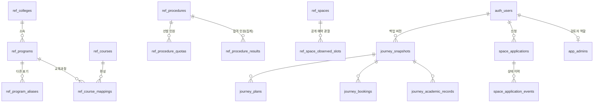

# 한성 메이트 데이터베이스 설계

기준일: 2026-10-26. Supabase(PostgreSQL)가 앱의 저장소다. `prisma/schema.prisma`는 초기 NestJS API 초안으로 남아 있으며 웹앱은 사용하지 않는다.

## 1. 세 영역

| 영역 | 테이블 | 누가 읽나 | 누가 쓰나 |
|---|---|---|---|
| 학교 기준 데이터 | `ref_*` 14개 + `ref_program_courses` 뷰 | 누구나(anon 포함) | 서비스 롤 시드만 |
| 개인 백업 | `journey_snapshots`, `journey_plans`, `journey_bookings`, `journey_academic_records`, `journey_documents` + 비공개 PDF 버킷 | 본인만 | 본인만(추가 전용, 버전 누적) |
| 공유 신청·검토 | `space_applications`, `space_application_events`, `app_admins` | 본인 + 검토자 | RPC로만 상태 변경 |



## 2. 학교 기준 데이터 (`ref_*`)

- 출처: 한성대학교 공개 홈페이지(대학별 교육과정·졸업요건 페이지, 학사 공지 2023~2026, 학사·교양·공간 안내). 원본은 `data/raw/hansung-2026-10-26/`에, 정규화 결과는 `data/normalized/reference.json`·`spaces.json`에 있다.
- 프로그램 상태: `ACTIVE`(2026-2 선택 가능 또는 현재 과목표 공개), `LEGACY`(이전 트랙, 재학생 설문·계획용), `FUTUREPLUS`(미래플러스대학), `CONTRACT`(계약학과).
- 과목 코드가 공개되지 않은 학과(글로벌인재대학, 문학문화콘텐츠학과 등)는 `NC-` 합성 코드를 쓰고 `code_verified = false`로 둔다.
- 이수구분은 `전기·전필·전선·일선·미분류`로 정규화하고, 원문 표기는 `category_as_published`에 남긴다.
- 전과·트랙 변경 결과는 **학부별 합격 인원 집계만** 저장한다. 공지의 마스킹된 학번·이름은 저장하지 않는다.
- 합격자 평균 학점은 학교가 공개하지 않아 `average_gpa`는 비워 둔다.

갱신 순서:

```bash
python3 -I scripts/build-reference.py        # 원본 → reference.json
python3 -I scripts/build-spaces.py           # 원본 → spaces.json
python3 -I scripts/build-reference-seed.py   # → supabase/seed/reference.sql
psql "$DATABASE_URL" -f supabase/seed/reference.sql   # 서비스 롤로 적용
```

## 3. 공유 신청·검토 흐름

1. 학생이 앱에서 신청을 제출하면 기기에 저장하고, 로그인 상태라면 `submit_space_application`으로 공유 신청함에도 올린다. 서명한 PDF는 본인 폴더에 업로드된다.
2. 바로 예약(`INSTANT`)은 즉시 `APPROVED`, 시험기간 상주(`EXAM`)는 `CHECKED_IN`, 강의실·야간 잔류는 `REVIEW`로 시작한다.
3. 검토자는 `app_admins`에 `SPACE_REVIEWER`로 등록된 계정이다. 등록은 운영자가 서비스 롤로만 한다.
   ```sql
   insert into public.app_admins(user_id, role) values ('<검토자 auth.users id>', 'SPACE_REVIEWER');
   ```
4. 검토자는 `review_space_application(id, APPROVE|REQUEST_CHANGES|REJECT, note, expected_revision)`로 처리한다. 보완·반려는 사유가 필요하고, 다른 검토자가 먼저 처리했으면 revision 불일치로 막힌다.
5. 학생은 보완 요청 건을 다시 제출할 수 있고(revision+1), 승인 후 입실·퇴실·취소는 `update_my_space_application`으로 한다.
6. 모든 상태 변화는 `space_application_events`에 남는다. 테이블 직접 UPDATE는 권한이 없다.
7. 검토자는 자신이 볼 수 있는 신청에 연결된 PDF만 서명 URL로 열 수 있다.

## 4. 검증

`scripts/verify-migrations.mjs`가 메모리 Postgres(PGlite)에 auth·storage 스텁을 만들고 모든 마이그레이션을 적용한 뒤 다음을 확인한다: 학생은 승인 불가, 사유 없는 반려 차단, 보완 후 재제출, 동시 처리(revision) 충돌 차단, 직접 UPDATE 차단, 익명은 기준 데이터 읽기만 가능.

```bash
npm i --no-save @electric-sql/pglite@0.2.17
node scripts/verify-migrations.mjs supabase/migrations/*.sql
```

## 5. 남은 연결

- 실제 Supabase 프로젝트에 새 마이그레이션·시드를 적용하려면 프로젝트 접근 권한(서비스 롤)이 필요하다.
- 웹앱은 지금 기준 데이터를 번들된 JSON에서 읽는다. 시드 후 `ref_program_courses` 뷰로 바꾸면 앱 배포 없이 데이터만 갱신할 수 있다.
